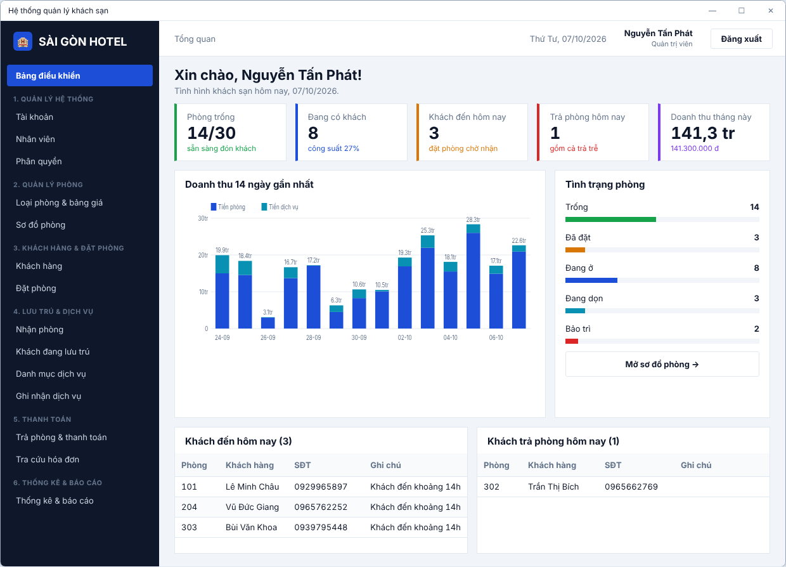
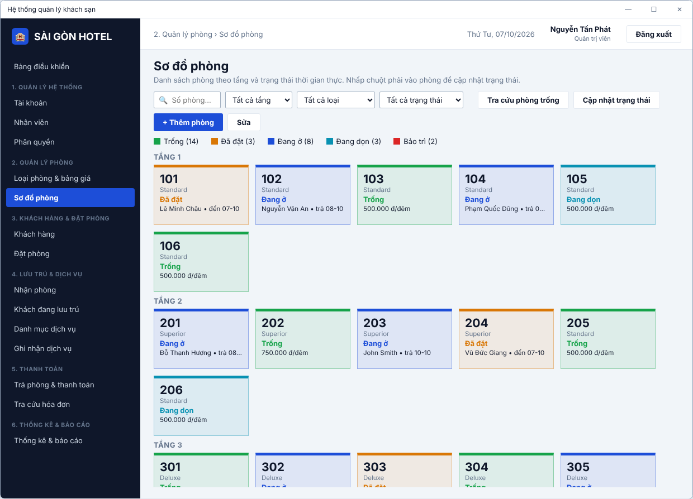

# Hệ thống quản lý khách sạn (demo giao diện)

Đồ án kết thúc môn học – bản demo giao diện viết bằng **C# WinForms (.NET 8)**, bám theo file đặc tả: sơ đồ BFD 6 nhóm chức năng và mô hình dữ liệu 13 lớp (`LuuTru` là lớp trung tâm).

Bản demo dùng **dữ liệu mẫu trong bộ nhớ** (30 phòng, 18 khách, khoảng 900 lượt lưu trú trong 6 tháng để thống kê có số liệu). Chưa kết nối cơ sở dữ liệu; mọi thay đổi mất khi tắt ứng dụng.

## Chạy ứng dụng

Yêu cầu: Windows, [.NET 8 SDK](https://dotnet.microsoft.com/download/dotnet/8.0) (hoặc Visual Studio 2022).

```bash
dotnet run --project src/HotelManagement
```

hoặc mở `HotelManagement.sln` bằng Visual Studio rồi nhấn F5.

Tài khoản demo (mật khẩu đều là `123`):

| Tên đăng nhập | Vai trò | Thấy các chức năng |
|---|---|---|
| `admin` | Quản trị viên | Tất cả |
| `quanly` | Quản lý | Tổng quan, sơ đồ phòng, đặt phòng, lưu trú, hóa đơn, thống kê |
| `letan` | Lễ tân | Khách hàng, đặt/nhận/trả phòng, dịch vụ, hóa đơn |
| `buongphong` | Nhân viên buồng phòng | Sơ đồ phòng (cập nhật dọn dẹp / bảo trì / sẵn sàng) |
| `letan2` | Lễ tân | Tài khoản bị khóa, để thử thông báo lỗi đăng nhập |

## Xem trước không cần Windows

`docs/preview/index.html` là bản mô phỏng HTML của các màn hình (cùng bố cục, màu và dữ liệu mẫu). Mở bằng trình duyệt bất kỳ. Ảnh chụp từ bản mô phỏng này nằm trong `docs/screenshots/`.




## Màn hình theo sơ đồ BFD

| BFD | Màn hình | File |
|---|---|---|
| 1.1, 1.2 | Đăng nhập, đăng xuất | `Forms/LoginForm.cs`, `Forms/MainForm.cs` |
| 1.3 | Quản lý tài khoản (khóa/mở, đặt lại mật khẩu) | `Views/HeThongViews.cs` |
| 1.4 | Quản lý nhân viên | `Views/HeThongViews.cs` |
| 1.5 | Phân quyền (ma trận chức năng × vai trò) | `Views/HeThongViews.cs` |
| 2.1 | Loại phòng & bảng giá theo thời gian (Tết, lễ) | `Views/PhongViews.cs` |
| 2.2–2.4 | Sơ đồ phòng theo tầng, cập nhật trạng thái, tra cứu phòng trống | `Views/PhongViews.cs` |
| 3.1 | Quản lý khách hàng + lịch sử lưu trú | `Views/DatPhongViews.cs` |
| 3.2–3.5 | Tiếp nhận / sửa / hủy / tra cứu đặt phòng, chống trùng phòng | `Views/DatPhongViews.cs` |
| 4.1 | Nhận phòng (theo đặt phòng hoặc khách vãng lai) | `Views/LuuTruViews.cs` |
| 4.2, 4.5 | Quản lý lưu trú, theo dõi khách đang ở (thêm khách, gia hạn, đổi phòng) | `Views/LuuTruViews.cs` |
| 4.3 | Danh mục dịch vụ | `Views/LuuTruViews.cs` |
| 4.4 | Ghi nhận sử dụng dịch vụ | `Views/LuuTruViews.cs` |
| 5.1–5.5 | Trả phòng, tính tiền phòng + dịch vụ, lập hóa đơn, thanh toán (một phần/đủ), in hóa đơn | `Views/ThanhToanViews.cs` |
| 5.6 | Tra cứu hóa đơn + lịch sử thanh toán | `Views/ThanhToanViews.cs` |
| 6.1–6.5 | Thống kê phòng, khách hàng, doanh thu; báo cáo doanh thu; xuất CSV (mở bằng Excel) | `Views/ThongKeViews.cs` |

## Cấu trúc

```
src/HotelManagement/
  Models/      13 lớp dữ liệu theo đặc tả + hằng số trạng thái
  Data/        MockDb (dữ liệu mẫu), HotelService (nghiệp vụ), Session, Menu (BFD + phân quyền)
  UI/          Theme (màu, font), UiKit (nút, lưới, xuất CSV), Components (khung màn hình, hộp thoại, biểu đồ)
  Forms/       LoginForm, MainForm
  Views/       Các màn hình chức năng
docs/preview/  Bản xem trước HTML
docs/screenshots/  Ảnh chụp các màn hình
.github/workflows/build.yml  CI: build trên Windows mỗi lần đẩy code, kèm bản chạy được (tab Actions → Artifacts)
```

Giao diện được dựng bằng code (không dùng file `.Designer.cs`) để các màn hình dùng chung một phong cách.

## Bước tiếp theo cho hệ thống chính

- Thay `Data/MockDb.cs` bằng tầng truy cập SQL Server (ADO.NET hoặc Entity Framework Core); các màn hình chỉ gọi qua `HotelService` nên ít phải sửa.
- Mã hóa mật khẩu (hiện để dạng chữ thường cho demo).
